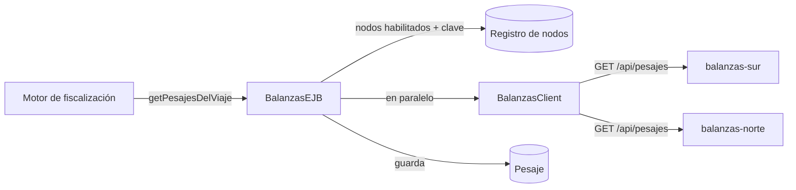

# Balanzas

[Proyecto](../README.md) · [Nodo de balanzas](../nodo-balanzas/README.md) · [Mensajería](mensajeria.md)

El central consulta los pesajes de un viaje a todos los nodos de balanzas habilitados. Si alguno no
responde, la evaluación de exceso de carga queda pendiente y se reintenta hasta que respondan todos.

## Piezas

| Pieza | Dónde | Qué hace |
| --- | --- | --- |
| `NodoBalanzasApi` | `adaptadores/balanzas` | Describe `GET /api/pesajes` del nodo (MicroProfile Rest Client) |
| `BalanzasClient` | `adaptadores/balanzas` | Llama a un nodo con su clave, con espera, reintentos y corte |
| `BalanzasEJB` | `negocio/balanzas` | Consulta a todos los nodos en paralelo y guarda los pesajes |
| `Pesaje` | `entities` | Copia de cada pesaje recibido, con su balanza y su peaje |
| `NodoPeriferico.claveCifrada` | `entities` | Clave del central para cada nodo, cifrada con `Cifrado` (Tink) |



## Contrato para el motor

```java
@EJB
BalanzasEJBLocal balanzas;

PesajesViajeDto resultado = balanzas.getPesajesDelViaje(viaje);
resultado.getPesajes();           // pesajes del vehiculo dentro del horario del viaje
resultado.isCompleto();           // false si algun nodo no respondio
resultado.getNodosSinResponder(); // cuales
```

- A cada nodo se le pregunta por cada fecha del viaje: un viaje que cruza la medianoche consulta dos días.
- Se guardan todos los pesajes recibidos. Los que caen fuera del horario del viaje quedan sin viaje: son
  evidencia de viaje sin guía.
- Un pesaje se identifica por `nodo/balanza/idRegistro` (`balanzas-sur/balanza-r5-km30/1001`). Volver a
  consultar no lo duplica.
- Un nodo deshabilitado no se consulta: el resultado sale completo sin él.

## Tolerancia a fallas

`BalanzasClient` usa las anotaciones de MicroProfile Fault Tolerance, como `LdapClient`:

| Mecanismo | Valor (AC13) |
| --- | --- |
| Espera por llamada | 5 s |
| Reintentos | 2, a 1 s y a 2 s |
| Corte | 60 s tras 5 fallas en 10 llamadas |
| Rechazo del nodo (4xx, clave mala) | No se reintenta ni cuenta para el corte |

El corte es uno solo para todas las balanzas: las anotaciones guardan un estado por método, no por nodo.
Si se cae un nodo también se deja de preguntar a los demás durante 60 s. La evaluación de exceso de carga
necesita los pesajes de todos los nodos, así que queda pendiente igual.

## Evaluación pendiente

Lo pendiente es del motor, como indica el diagrama de secuencia del CU-11 (`marcarPendiente()`): el
adaptador no guarda estado.

1. El motor llama a `getPesajesDelViaje` al terminar el viaje y evalúa con los pesajes que recibió.
2. Si el resultado no está completo, marca el viaje: `Viaje.proximaEvaluacionCarga = ahora + 1 min`.
3. Un temporizador (`@Schedule(minute = "*", persistent = false)`) toma cada minuto los viajes cuya marca
   ya venció y le pide al motor que los vuelva a evaluar.
4. Cuando el resultado está completo, el motor borra la marca (`proximaEvaluacionCarga = null`).

Volver a evaluar es seguro: los pesajes no se duplican por su `idOrigen` y los casos tampoco, por su
clave de deduplicación. Es el mismo patrón que el informe define para el correo en AC13.

### Ejemplo

El viaje 87 de SCC9012 termina a las 14:00. `balanzas-sur` responde y `balanzas-norte` está caído.

| Hora | Qué pasa | `proximaEvaluacionCarga` |
| --- | --- | --- |
| 14:00 | Sur devuelve 36.500 kg (límite 33.800): se crea el caso. Norte no responde | 14:01 |
| 14:01 | El temporizador lo toma; norte sigue caído | 14:02 |
| 14:02 a 14:14 | Lo mismo cada minuto | un minuto después |
| 14:15 | Norte vuelve con 35.900 kg: se agrega al caso existente. Resultado completo | `null` |

### Varias instancias del central

Cada instancia corre el temporizador. Para que un viaje lo tome una sola, el temporizador lo reserva con
una única sentencia en PostgreSQL:

```sql
UPDATE viaje SET proximaEvaluacionCarga = :hasta
WHERE id IN (SELECT id FROM viaje WHERE proximaEvaluacionCarga <= :ahora
             ORDER BY proximaEvaluacionCarga LIMIT :n FOR UPDATE SKIP LOCKED)
RETURNING id
```

`FOR UPDATE SKIP LOCKED` hace que cada instancia saltee las filas que otra ya bloqueó, y correr la marca a
`:hasta` reserva el viaje por un minuto. Si la instancia se cae, la marca vence y otra lo toma.

Otras formas descartadas:

| Alternativa | Por qué no |
| --- | --- |
| Tabla de consultas pendientes en el adaptador | Concepto técnico fuera del modelo; lo pendiente es del motor |
| Cola JMS con entrega diferida | Lo pendiente queda oculto en la cola y se agota en la cola de mensajes muertos, cuya política está pendiente |
| Timers persistentes de WildFly | Necesitan el perfil `ha` o un almacén en base configurado en el servidor |
| Reintentar en memoria | Se pierde en un reinicio y no funciona con varias instancias |

## Pendientes

- [ ] Motor (Lote 4): regla de exceso de carga con `getPesajesDelViaje`, la marca en `Viaje` y el
      temporizador.
- [ ] Prueba con el compose: un nodo caído, los reintentos, el corte y la evaluación pendiente (AC14).
- [ ] Informe: `proximaEvaluacionCarga` en el modelo de dominio; en AC13, el temporizador de Balanzas; en
      DA10, el mecanismo; en CU-19, que deshabilitar un nodo lo saca de la consulta en vez de dejar la
      evaluación pendiente.
