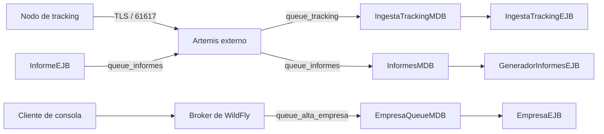

# Mensajería

[Proyecto](../README.md) · [Seguridad](seguridad.md#seguridad-de-los-nodos) · [Observabilidad](observabilidad.md)

El sistema utiliza dos destinos JMS con configuraciones distintas. Las posiciones de tracking
se reciben mediante un broker Artemis externo, compartido por las instancias del central.
El alta asíncrona de empresas usa el broker embebido de WildFly.

## Productores, destinos y consumidores

| Productor | Destino | Broker | Consumidor |
| --- | --- | --- | --- |
| Nodo de tracking | `queue_tracking` | Servicio `artemis` | `IngestaTrackingMDB` |
| `InformeEJB` (exportación de reportes) | `queue_informes` | Servicio `artemis` | `InformesMDB` |
| Cliente de consola | `queue_alta_empresa` | WildFly | `EmpresaQueueMDB` |



El central accede al broker externo por `artemis:61616`, con la connection factory
`java:/jms/ArtemisCF`. Los destinos locales son `java:/jms/queue/queue_tracking` y
`java:/jms/queue/queue_informes`.
[artemis.cli](../carga-uy/config/artemis.cli) configura la conexión y
[jboss-ejb3.xml](../carga-uy/carga-uy-ejb/src/main/resources/META-INF/jboss-ejb3.xml)
asocia los MDB de tracking y de informes al adaptador de recursos externo.

`queue_alta_empresa` se crea en el [Dockerfile](../carga-uy/Dockerfile), con entradas JNDI
`java:/jms/queue/queue_alta_empresa` y `java:jboss/exported/jms/queue/queue_alta_empresa`.

## Contrato de posiciones

Cada posición se envía como JSON en un `TextMessage`:

```json
{
  "idEvento": "evento-001",
  "nodo": "tracking-1",
  "matricula": "STA1234",
  "latitud": -34.9,
  "longitud": -56.1,
  "timestampGeneracion": "2026-10-26T12:00:00Z"
}
```

`timestampGeneracion` representa el instante de la posición, independiente de cuándo se publica
o recibe. El contexto de trazado viaja en la propiedad JMS `traceparent`.
El consumidor está implementado en
[IngestaTrackingMDB](../carga-uy/carga-uy-ejb/src/main/java/tse/cargauy/negocio/tracking/IngestaTrackingMDB.java).

La ingesta exige un nodo registrado, de tipo `TRACKING` y habilitado. Una matrícula desconocida
se conserva sin asociarla a un vehículo. Cuando existe un vehículo, la asociación al viaje usa
la hora de generación; si el inicio del viaje llega después, las posiciones pueden reasociarse.

## Persistencia y deduplicación

Artemis persiste los mensajes en el volumen `artemisdata`. Si WildFly está detenido, el nodo puede
seguir publicando al broker. Ante una desconexión del broker, el generador mantiene pendientes
en memoria y reintenta; esos pendientes todavía no tienen la persistencia del broker.

Las posiciones se guardan en MongoDB, en `cargauy.posiciones`, con identidad única por
`idNodo` e `idEvento`. MongoDB no participa de la transacción JMS del consumidor: una reentrega
puede encontrar la posición ya almacenada. La ingesta detecta ese caso y, si sigue sin marcarse
como procesada, retoma los pasos posteriores. Los resultados distinguen `REGISTRADO`,
`COMPLETADO` y `DUPLICADO`.

Referencias: [IngestaTrackingEJB](../carga-uy/carga-uy-ejb/src/main/java/tse/cargauy/negocio/tracking/IngestaTrackingEJB.java)
y [EventoPosicionDAO](../carga-uy/carga-uy-datos/src/main/java/tse/cargauy/data/posicion/EventoPosicionDAO.java).

## Errores y reentregas

| Situación en tracking | Comportamiento |
| --- | --- |
| Mensaje malformado | Se registra el error y se descarta, sin relanzar la excepción |
| Nodo desconocido, de otro tipo o deshabilitado | Se registra el resultado y no se almacena la posición |
| Fallo inesperado durante el procesamiento | Se relanza la excepción para permitir la reentrega |
| Se alcanza el límite de entregas | El broker deriva el mensaje a `DLQ` |

Para `queue_tracking`, [broker.xml](../carga-uy/artemis/etc/broker.xml) reentrega con una espera que
se duplica en cada intento (1 s, 2 s, 4 s… hasta 60 s) y hasta 20 entregas: el central puede estar
unos 14 minutos sin poder procesar (por ejemplo, con PostgreSQL caído) sin perder posiciones. Cada
mensaje espera por su cuenta, así que la espera no frena al resto. Recién después pasa a `DLQ`. La
dirección de expiración es `ExpiryQueue`. La política `PAGE` lleva mensajes a disco al superar el
umbral de memoria configurado de `10M`.

Sin espera entre reentregas, los intentos se agotaban en segundos: con PostgreSQL detenido 20 s,
12 posiciones terminaban en `DLQ`.

### Mensajes muertos

El tablero muestra los mensajes de `DLQ` en el panel **Cola de tracking** (`cola_mensajes` con
`cola="DLQ"`); en funcionamiento normal es 0. Para volver a procesarlos, una vez resuelta la causa: en
la consola del broker, **Queues → DLQ**, seleccionar los mensajes y **Retry**, que los devuelve a su
cola de origen. Reprocesar es seguro: la ingesta descarta los duplicados (DA07).

La consola del broker está en http://localhost:8161/, con `artemis` / `artemis` en desarrollo.
Permite inspeccionar la cola y la DLQ; las métricas y la correlación con errores del consumidor
están en [observabilidad](observabilidad.md). La simulación de duplicados, desorden y desconexión
se configura desde el [nodo de tracking](../nodo-tracking/README.md#configuración).

## Contrato de exportaciones de reportes

`queue_informes` recibe un `TextMessage` con el id del `Informe` que la autoridad pidió desde el
tablero (CU-16). `InformeEJB.exportar` guarda el informe en estado `PENDIENTE` y envía el mensaje
dentro de la misma transacción, así que el broker solo lo entrega si el pedido quedó guardado.

`InformesMDB` llama a `GeneradorInformesEJB`, que vuelve a calcular los indicadores con los filtros
del informe, arma el CSV o el PDF y lo guarda con el estado `GENERADO`. Si el informe ya no está
pendiente (un mensaje reentregado), no hace nada. Si falla la generación, el informe queda `FALLIDO` y
la autoridad puede volver a pedirlo; si falla algo de infraestructura, la excepción sigue de largo y
el broker reentrega el mensaje cada 60 segundos, hasta 3 veces, antes de pasarlo a `DLQ`.

## Contrato de alta de empresas

`queue_alta_empresa` recibe un `TextMessage` con cinco campos separados por `|`:

```text
nroEmpresa|nombrePublico|razonSocial|direccionPrincipal|cedulaResponsable
```

`EmpresaQueueMDB` construye el DTO y llama a `EmpresaEJB` con `@RunAs(FUNCIONARIO)`.
Rechaza mensajes que no sean de texto o tengan menos de cinco campos. Registra las excepciones
de JMS, número inválido y negocio sin relanzarlas; este tratamiento es distinto al de fallos
inesperados en la ingesta de tracking.

El consumidor está en [EmpresaQueueMDB](../carga-uy/carga-uy-ejb/src/main/java/tse/cargauy/negocio/empresa/EmpresaQueueMDB.java).
La ejecución y las limitaciones actuales del productor están en el
[README del cliente de consola](../carga-uy-client/README.md).
