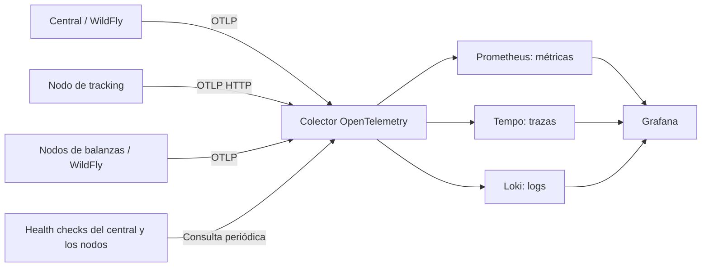

# Observabilidad

[Proyecto](../README.md) · [Infraestructura](infraestructura.md) · [Mensajería](mensajeria.md)

El central, el nodo de tracking y los nodos de balanzas envían métricas, trazas y logs a una plataforma basada en
`grafana/otel-lgtm`. El colector OpenTelemetry recibe las señales; Prometheus, Tempo y Loki
permiten consultarlas desde Grafana.

## Recorrido de las señales



La configuración de WildFly está en [observabilidad.cli](../carga-uy/config/observabilidad.cli) para el central y en
[observabilidad.cli](../nodo-balanzas/config/observabilidad.cli) para los nodos de balanzas, que se distinguen por
`OTEL_SERVICE_NAME` (`balanzas-sur`, `balanzas-norte`).
La imagen de la plataforma y su configuración están en [carga-uy/observabilidad](../carga-uy/observabilidad/).
El [colector](../carga-uy/observabilidad/otelcol-carga-uy.yaml) consulta cada 15 segundos la salud
de WildFly, la API del central, tracking y los nodos de balanzas.

## Métricas

| Origen | Señales principales |
| --- | --- |
| Central | Resultados y errores de ingesta, tiempo de procesamiento, espera en cola y antigüedad de posiciones |
| API REST y servidor | Volumen y tiempos de pedidos; métricas de JVM, Undertow, datasources y mensajería |
| Tracking | Eventos generados y publicados, duplicados, pendientes y reintentos |
| Broker externo | Mensajes pendientes y consumidores de `queue_tracking`, consultados por el central mediante Jolokia |
| Health checks | Disponibilidad del servidor, las bases de la aplicación y la conexión de tracking al broker |

Abrir http://localhost:3000/, carpeta **carga.uy**, tablero **carga.uy · ingesta, nodo y API**.
Incluye tiempos de la API con percentil 95 y paneles para ingesta, cola y nodo. La definición
versionada está en el [dashboard](../carga-uy/observabilidad/dashboards/carga-uy-ingesta.json).

La consulta del broker se implementa en
[MetricasCola](../carga-uy/carga-uy-ejb/src/main/java/tse/cargauy/negocio/tracking/MetricasCola.java).
Si esa consulta falla, publica un valor no disponible (`NaN`) en lugar de conservar una medida anterior.

## Trazas y correlación de logs

WildFly instrumenta las llamadas REST. Tracking abre una traza por lote publicado y agrega
`traceparent` a las propiedades de cada mensaje JMS. `IngestaTrackingMDB` extrae ese contexto
y crea el span de consumo; así se puede seguir una posición desde el nodo hasta el central.

La fiscalización corre en otro hilo (`@Asynchronous`), que no hereda la traza: `DisparadorFiscalizacion` le pasa la
del evento y `MotorFiscalizacionEJB` abre ahí su span. Las consultas a las balanzas corren en el ejecutor del
servidor, al que `BalanzasEJB` le pasa la traza; WildFly instrumenta el cliente REST y agrega `traceparent` a cada
consulta, y cada nodo de balanzas continúa la traza. Quedan así dos recorridos completos:

| Recorrido | Spans |
| --- | --- |
| Posición de tracking | `publish queue_tracking` (nodo) → `process queue_tracking` → `fiscalizacion evaluar posicion` |
| Fin de un viaje (AC23) | `POST /api/movil/sync` → `fiscalizacion evaluar viaje` → `GET` a cada nodo → `GET /api/pesajes` en `balanzas-sur` y `balanzas-norte` |
| Reevaluación de una carga pendiente | `fiscalizacion reevaluar carga` (temporizador, cada minuto mientras falte algún nodo) → `GET` a cada nodo → `GET /api/pesajes` |

En Grafana, **Explore → Tempo**, buscar por ejemplo `{name="fiscalizacion evaluar viaje"}` y abrir la traza.

La ingesta agrega a los logs `trace_id`, `span_id` e `id_evento`. En la consola de WildFly,
`trace_id` aparece después del nombre del hilo. El envío por OTLP permite correlacionar los
logs con las trazas en Grafana.

## Exportación y muestreo

| Variable del Compose | Destino o efecto predeterminado |
| --- | --- |
| `OTEL_ENDPOINT` | Trazas del central hacia `http://observabilidad:4317` |
| `OTEL_ENDPOINT_METRICAS` | Métricas del central hacia `http://observabilidad:4318/v1/metrics` |
| `OTEL_EXPORTER_OTLP_ENDPOINT` | Señales de tracking hacia `http://observabilidad:4318` |
| `OTEL_PROPORCION_TRAZAS` | Proporción de trazas conservadas, `1.0`; Compose aplica el mismo valor al central y tracking |

Se puede reducir el muestreo para pruebas de carga. Mantener la misma proporción en el central y
tracking permite muestrear de forma consistente los tramos de una traza. Tras editar `carga-uy/.env`,
aplicar los cambios desde `carga-uy`:

```sh
docker compose up -d carga-uy nodo-tracking
```

## Salud y diagnóstico

| Endpoint local | Qué comprueba |
| --- | --- |
| `http://localhost:9990/health/live` y `/health/ready` | Estado de WildFly; `/health` agrupa sus checks |
| `http://localhost:8080/carga-uy/api/salud` | PostgreSQL y MongoDB; devuelve `200` si ambos están disponibles y `503` si falla alguno |
| `http://localhost:8081/health` | Conexión de tracking con el broker; `200` conectado, `503` desconectado |
| `http://localhost:8081/metricas` | Contadores locales del generador de posiciones |

La salud de la API no comprueba el broker: sus operaciones pueden seguir disponibles aunque la
publicación de posiciones esté detenida. Para revisar el estado de los contenedores y sus logs,
desde `carga-uy`:

```sh
docker compose ps -a
docker compose logs -f carga-uy nodo-tracking
```

Si crece la cola, revisar consumidores, errores de ingesta y disponibilidad de las bases.
Si aumentan los pendientes del nodo, revisar su conexión al broker. Los resultados
`NODO_DESCONOCIDO` y `NODO_NO_HABILITADO` indican problemas de registro o habilitación.
El tratamiento de descartes y reentregas está explicado en [mensajería](mensajeria.md#errores-y-reentregas).
