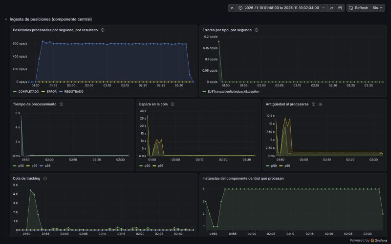
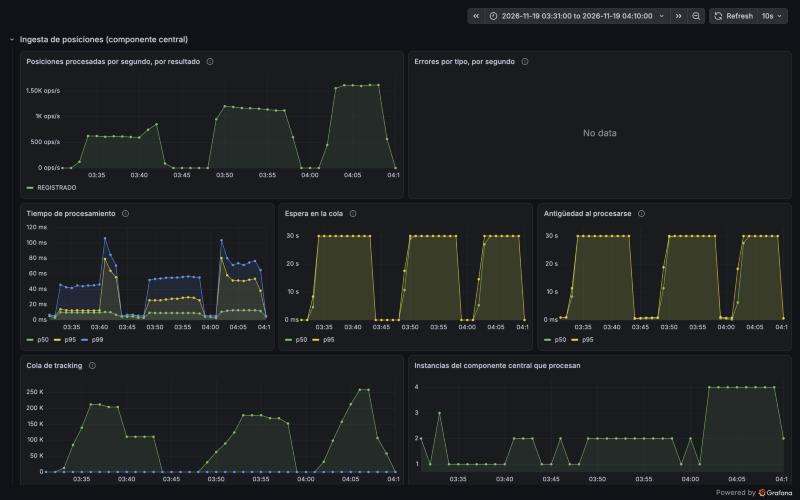
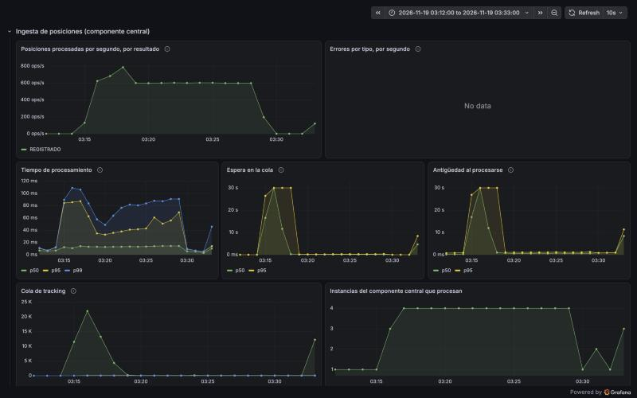

# Performance

[Proyecto](../README.md) · [Observabilidad](observabilidad.md) · [Mensajería](mensajeria.md)

## Volumen objetivo de tracking

El informe ([Vista de Atributos de Calidad](informe/vista-atributos-calidad.tex), AC08) fija el volumen:

| | Valor | De dónde sale |
| --- | --- | --- |
| Flota profesional | 17.869 vehículos con motor (2019) | Registro del MTOP, en el cuadro 2.1 del informe del BID (2022) |
| Vehículos reportando a la vez | **18.000** | Peor caso: toda la flota con un viaje en curso, redondeado |
| Frecuencia de reporte | una posición cada 30 s | Requisito de carga.uy: ~670 m entre posiciones a 80 km/h |
| Volumen objetivo | **600 posiciones/s** | 18.000 / 30 |
| Pico (×3) | **1.800 posiciones/s** | Vehículos que recuperan cobertura y descargan lo acumulado |

La justificación completa, y por qué la estimación queda del lado alto, está en la sección "Volumen
objetivo de tracking" del informe.

## Cómo generar la carga

El nodo de tracking suma vehículos simulados (`SIM0001`, `SIM0002`…) con rutas al azar.
`NODO_VEHICULOS_EXTRA=N` con `NODO_INTERVALO_SEG=S` genera unas `N / S` posiciones por segundo.
El intervalo por defecto del compose es de 10 s, para que en desarrollo y en la demo el recorrido
de la flota de prueba se vea rápido. La prueba de performance usa el volumen del informe: 18.000
vehículos cada 30 s, repartidos entre los dos nodos. Desde `carga-uy`:

    NODO_INTERVALO_SEG=30 NODO_VEHICULOS_EXTRA=9000 NODO_2_VEHICULOS_EXTRA=9000 \
      docker compose up -d nodo-tracking nodo-tracking-2

Para el pico hay dos formas. `NODO_INTERVALO_SEG=10` con la misma flota triplica la carga de forma pareja (1.800
posiciones/s con los 18.000 vehículos): es la que se usó en OpenShift. `NODO_SIN_COBERTURA=desde,durante` (en minutos)
retiene las posiciones y las publica todas juntas al volver la cobertura, que es más fiel al caso real pero llega de
golpe. Para volver a la flota normal, `NODO_VEHICULOS_EXTRA=0`.

Se mira en Grafana, en el tablero **carga.uy · ingesta, nodo y API**:
- posiciones generadas en el nodo frente a procesadas en el central;
- la cola de tracking, que tiene que estabilizarse y no crecer sin límite;
- la espera en la cola y la antigüedad de cada posición al procesarse;
- el tiempo de procesamiento.

Sin el [juego de datos](#juego-de-datos), las matrículas simuladas no están registradas: se guardan sin vehículo y no
pasan por la fiscalización, así que la carga por posición queda por debajo de la real.

## Juego de datos

[performance/datos.sql](../performance/datos.sql) registra en el central la flota del volumen objetivo, para que cada
posición recorra la operativa real: vehículo conocido, viaje en curso, permiso e ITV vigentes, y las reglas de
fiscalización. Con los valores por defecto:

| Qué | Cantidad |
| --- | --- |
| Empresas, cada una con su responsable | 90 |
| Vehículos `SIM0001` a `SIM18000`, con permiso aprobado, ITV, chofer, un viaje en curso y el siguiente asignado | 18.000 |
| Vehículos con la ITV vencida (su primera posición del día abre un caso "sin habilitación") | 180 (1 %) |
| Viajes terminados, con su Guía y sus eventos de inicio y fin: 6 meses de historia | 108.000 |
| Casos de exceso de carga notificados, con su evidencia | 2.160 |
| Funcionarios para el escenario de k6 | 5 |

Los nodos generan exactamente esas matrículas: `tracking-1` desde `SIM0001` y `tracking-2` desde `SIM9001`
(`NODO_VEHICULOS_DESDE`). Las cantidades se cambian con parámetros de `psql` (`-v vehiculos=6000 -v meses=3`;
la lista está en el encabezado del script). Los ids arrancan en 10.000.000, lejos de los que asigna la aplicación, y
las cédulas son inventadas.

Se carga sobre una base con solo los datos de referencia, con el perfil `performance` del reinicio
([datos del central](infraestructura.md#datos-del-central)):

```sh
cd carga-uy/openshift && ./reiniciar-datos.sh --perfil performance     # unos 15 s de carga
```

Para volver a la demo, `./reiniciar-datos.sh`. Como el reinicio parte siempre de una base vacía y el script da
siempre los mismos datos, cada corrida arranca del mismo punto; las fechas son relativas al día de la carga.

## Usuarios simulados del frontoffice (k6)

Mientras el generador de tracking carga la ingesta, `performance/frontoffice.js` simula con
[k6](https://k6.io) a los usuarios del frontoffice, para verificar el objetivo de p95 < 500 ms en
sus consultas (AC09). Tiene tres escenarios con llegada constante de pedidos (`TASA` iteraciones por
segundo cada uno):

- **Responsable de empresa:** sus viajes, el detalle y los eventos de uno, sus vehículos y sus infracciones.
- **Funcionario:** empresas, vehículos y casos de fiscalización.
- **Público, sin sesión:** validación de una empresa e indicadores del año.
- **Móvil (opcional, `TASA_MOVIL` choferes por segundo):** el chofer de un vehículo `SIM` pide sus viajes en la app y
  manda en un mismo envío el fin del viaje en curso y el inicio del siguiente, que el
  [juego de datos](#juego-de-datos) deja asignado. Al terminar el viaje, el central lo evalúa en segundo plano y le pide
  los pesajes a los nodos de balanzas: es el camino que ejercita la fiscalización de exceso de carga y las balanzas
  con carga. Con 18.000 vehículos y viajes de unas 5 horas termina un viaje por segundo (`TASA_MOVIL=1`). Cada
  iteración usa el vehículo siguiente, desde `MOVIL_DESDE` (1 por defecto): en otra corrida sobre la misma carga de
  datos hay que arrancar después de los ya usados, o reiniciar los datos.

Los tokens no pasan por gub.uy: el script los firma con el mismo secreto del central
(`CARGAUY_JWT_SECRET`) y las mismas claims que `UsuarioEJB`. Los usuarios salen de la base:

```bash
KUBECONFIG=~/.kube/demo-central performance/usuarios.sh   # genera performance/usuarios.json (no se versiona)
k6 run -e JWT_SECRETO="$CARGAUY_JWT_SECRET" -e TASA=10 -e DURACION=10m performance/frontoffice.js
k6 run -e JWT_SECRETO="$CARGAUY_JWT_SECRET" -e TASA=5 -e TASA_MOVIL=1 -e DURACION=10m performance/frontoffice.js
```

Los umbrales de k6 fallan la corrida si el p95 de algún escenario pasa de 500 ms o si más del 1 %
de los pedidos fallan. `BASE_URL` cambia el destino (por defecto, el central en OpenShift).

Corrida de humo del 18/11/2026 contra OpenShift (`TASA=1`, `DURACION=30s`, una instancia, sin carga de
tracking): 298 pedidos sin errores, p95 de 164 ms (público), 174 ms (responsable) y 206 ms
(funcionario). El pedido más rápido tardó 147 ms, que es casi todo red entre la máquina que corre k6 y el
clúster: conviene anotar ese piso junto con los resultados de la prueba.

## Prueba preliminar (26/10/2026, máquina de desarrollo)

Todo el compose en una sola Mac de 8 núcleos y 8 GB para Docker: el nodo de tracking que genera la
carga, el broker, el central, las dos bases y los nodos de balanzas. Escalones de unos 2,5 minutos,
con el intervalo de 10 s del compose: cada escalón llega a la misma carga que el triple de vehículos
reportando cada 30 s.

| Vehículos | Objetivo (pos/s) | Generadas (pos/s) | Procesadas (pos/s) | Cola (máx.) | Espera p95 | Procesamiento p95 |
| --- | --- | --- | --- | --- | --- | --- |
| 1.000 | 100 | 85 | 88 | 1.002 | 10,9 s | 38 ms |
| 2.500 | 250 | 250 | 279 | 2.192 | 12,6 s | 8,4 ms |
| 5.000 | 500 | 500 | 521 | 9.932 | ≥ 30 s | 7,7 ms |

- Hasta 250 posiciones/s el central procesa lo que llega y la cola se mantiene acotada.
- En 500 posiciones/s procesa en promedio lo que llega, pero la cola oscila entre 6.000 y 11.000
  mensajes y la espera llega al tope del histograma (30 s). Al sostenerlo, la máquina se satura
  (load average de 20 en 8 núcleos): el propio generador baja a ~230 posiciones/s y la ingesta cae.
- Cada posición se procesa en menos de 8 ms (p95). El cuello de botella observado no es la ingesta
  sino la CPU compartida por todos los contenedores, el generador incluido.
- El primer escalón arrancó con la cola de una prueba anterior; sus esperas no son representativas.

Conclusión: en la máquina de desarrollo el punto de quiebre está entre 250 y 500 posiciones/s. Para
la prueba de performance de la entrega final (AC09 a AC11) hay que separar el generador del central
y correrla con el central en la nube (se hizo en OpenShift: ver la sección siguiente). Las varias instancias del central consumen la misma cola
(DA02), así que se puede medir también el escalado horizontal.

## Prueba en OpenShift (18 y 19/11/2026)

### Objetivos y resultado

| Objetivo (letra, sección 4.3) | Resultado | Dónde |
| --- | --- | --- |
| p95 de las consultas del frontoffice < 500 ms | ✅ 168 a 426 ms con 600 pos/s, también durante 40 minutos y con una balanza caída | [Resultados](#resultados), [corrida larga](#sin-degradación-en-el-tiempo) |
| Sostener el volumen estimado (600 pos/s) sin pérdida | ✅ procesa lo que llega, cola estable y DLQ en 0 (los únicos errores son reentregas al apagarse una instancia) | [Resultados](#resultados) |
| Los tiempos no se degradan a lo largo de la prueba | ✅ 40 minutos con p95 estable | [Corrida larga](#sin-degradación-en-el-tiempo) |
| Punto de quiebre | ~1.600 pos/s con 4 instancias, limitado por la CPU de PostgreSQL | [Escalado](#escalado-horizontal) |
| Cuellos de botella, con evidencia de la observabilidad | Índices, memoria y CPU de PostgreSQL, una consulta pública repetida, MongoDB, CPU del central | [Qué limitó cada corrida](#qué-limitó-cada-corrida) |
| Pico ×3 (1.800 pos/s) | Se encola y se procesa con atraso, sin pérdida | [Pico](#pico-de-1800-posicioness) |
| Balanzas indisponibles | El central sigue respondiendo; el viaje queda pendiente y se reevalúa al volver el nodo | [Escenarios de falla](#escenarios-de-falla) |
| PDI que no responde | El ingreso sigue funcionando con el perfil pendiente | [Escenarios de falla](#escenarios-de-falla) |
| Escalado horizontal efectivo (opcional 4) | 1 → 2 instancias: ×1,9; 2 → 4: ×1,4 | [Escalado](#escalado-horizontal) |

### Entorno

| Componente | Recursos (límite) | Notas |
| --- | --- | --- |
| Central (WildFly) | 2 CPU, 2 GiB por instancia | Autoescalado de 1 a 4 instancias por CPU (70 %) |
| PostgreSQL | 1 CPU y 512 MiB al empezar; 2 CPU y 2 GiB; **4 CPU y 2 GiB** desde la corrida 4 | Queda en 4 CPU ([infraestructura](infraestructura.md)) |
| MongoDB | 1 CPU; **2 CPU** desde la prueba de escalado; 1 GiB y 5 GiB de disco | Queda en 2 CPU |
| Artemis | 1 CPU, 2,5 GiB | Cola `queue_tracking` |
| Nodos de tracking (2) | 1 CPU cada uno | En otro proyecto del mismo clúster; publican al Artemis del central por su ruta |
| Nodos de balanzas (2) | | En otro clúster de OpenShift; el central les pregunta por HTTPS |
| k6 | Máquina de desarrollo | Unos 280 ms de cada pedido son TLS y red hasta el clúster |

La base se carga con el [juego de datos](#juego-de-datos) antes de cada corrida (perfil `performance`). La carga de
tracking se sube por escalones con `NODO_VEHICULOS_EXTRA` (2.250 vehículos extra por nodo = 150 posiciones/s en total)
y el frontoffice se simula con k6 con `TASA=5` (15 iteraciones/s entre los tres escenarios, unos 50 pedidos/s). Cada
15 s se registran las métricas de Prometheus (generadas, publicadas y procesadas por segundo, cola, tiempos de la
ingesta, uso del pool) y la CPU de cada pod (`oc adm top`); cuando hace falta, también qué consultas están activas en
`pg_stat_activity`. Los datos crudos de cada corrida (decenas de MB) no se versionan.

### Resultados

| Corrida | Cambios | Carga | Procesadas (pos/s) | Frontoffice p95 | Errores k6 | CPU PostgreSQL |
| --- | --- | --- | --- | --- | --- | --- |
| 1 | Ninguno: PostgreSQL con el límite por defecto (1 CPU, 512 MiB) | 150 pos/s | ~14 | | | 1 CPU (tope); reinicios por memoria (OOMKilled) |
| 2 | Índices de claves foráneas; PostgreSQL a 2 CPU y 2 GiB | 150 / 300 / 600 pos/s | 150 / 300 / 600 | | | 0,44 / 0,85 / 1,7–2 CPU |
| 2 | | 600 pos/s + k6 | ~22 | 8,5 s / 9,3 s / 20,7 s | 10 % | 2 CPU (tope) |
| 2 | | k6 solo | | 6,5 s / 7,2 s / 18,1 s | 8,9 % | 2 CPU (tope) |
| 3 | Caché de indicadores públicos e índice de guías por empresa | k6 solo | | 296 / 258 / 163 ms | 0 % | |
| 3 | | 600 pos/s + k6 | ~460 | 1,9 s / 2,4 s / 3,4 s | 2,4 % | 2 CPU (tope) |
| 4 | PostgreSQL a 4 CPU | 600 pos/s + k6 | **600** | **347 / 351 / 168 ms** | **0 %** | ~2,2 CPU |
| 4 | | 900 pos/s | **900** | | | ~2,1 CPU |
| 5 | Ninguno (corrida larga) | 600 pos/s + k6, 40 min | **600** | **388 / 426 / 186 ms** | **0 %** (120.000 pedidos) | 2,2–2,35 CPU |
| 6 | Regla de desvío de ruta, caché de normas, escenario móvil | 600 pos/s + k6 + 1 fin de viaje/s, 12 min, con `balanzas-norte` caída 4 min | **600** | **406 / 398 / 192 ms** | **0 %**; móvil: 100 % aplicados | 2,5–2,9 CPU |

Los p95 del frontoffice son de los escenarios funcionario / responsable / público. El tiempo de procesamiento de una
posición (p95) fue de 13 ms a 150 pos/s, 65 ms a 300 y entre 50 y 80 ms a 600 con k6; la espera en la cola (p95), de
unos 350 a 490 ms a 600 pos/s y 600 ms a 900. El autoescalado llevó el central a 4 instancias en todas las corridas
con carga. En la corrida 6 la base usa más CPU que en la 4 y la 5: suma la regla de desvío (la Guía del viaje con cada
posición) y la evaluación de un viaje terminado por segundo; con el límite de 4 CPU queda margen.

### Qué limitó cada corrida

1. **Faltaban índices.** PostgreSQL no indexa las claves foráneas, y la ingesta busca el viaje en curso, el permiso y
   la ITV por vehículo en cada posición. Sin índice, la búsqueda del viaje recorría la tabla entera (24 ms); con el
   índice, 0,1 ms. Se agregaron como `@Index` en las entidades.
2. **El límite por defecto del proyecto (1 CPU, 512 MiB) no alcanza para PostgreSQL.** Con 18.000 vehículos, la base
   se quedaba sin memoria y el contenedor se reiniciaba. Se subió a 2 CPU y 2 GiB
   ([infraestructura](infraestructura.md)).
3. **Una consulta pública repetida.** Con k6, la consulta de los indicadores públicos (agregados de meses sobre todos
   los viajes) era la que más aparecía en `pg_stat_activity`: se calculaba entera en cada pedido, aunque el resultado
   es el mismo para cualquiera que pida el mismo período. Le sacaba a la base la CPU que necesitaba la ingesta, que
   bajaba a 22 pos/s. Ahora cada instancia guarda el resultado 5 minutos (`CacheIndicadoresPublicos`). También
   faltaba un índice en `guia(empresa_id)` para el listado de viajes de una empresa.
4. **La CPU de PostgreSQL.** Con 2 CPU la base quedaba en su tope con 600 pos/s y k6 juntos; con 4 CPU usa unas 2,2 y
   se cumplen los dos objetivos a la vez.
5. **Por encima del volumen objetivo**, según la configuración: MongoDB en su límite de 1 CPU (pico), la CPU del
   central con una o dos instancias, y otra vez PostgreSQL con cuatro ([escalado](#escalado-horizontal)).

### Sin degradación en el tiempo

Corrida 5: 600 pos/s y k6 durante 40 minutos. p95 del frontoffice por tramos de 5 minutos:

| Minutos | Funcionario | Responsable | Público |
| --- | --- | --- | --- |
| 0–5 | 476 ms | 527 ms | 210 ms |
| 5–10 | 397 ms | 432 ms | 188 ms |
| 10–15 | 379 ms | 422 ms | 185 ms |
| 15–20 | 368 ms | 396 ms | 180 ms |
| 20–25 | 381 ms | 415 ms | 183 ms |
| 25–30 | 380 ms | 404 ms | 180 ms |
| 30–35 | 363 ms | 392 ms | 179 ms |
| 35–40 | 366 ms | 413 ms | 182 ms |



*Corrida 5 en el tablero de la ingesta: 600 pos/s parejas durante 40 minutos, con el procesamiento y la espera en la
cola planos después del arranque y 4 instancias. El único error, al principio, es una transacción deshecha cuando el
autoescalado apagó una instancia: el broker reentrega el mensaje a otra y no llega a la DLQ
([infraestructura](infraestructura.md#varias-instancias-y-autoescalado)).*

El primer tramo es más lento por el arranque (compilación de la JVM, cachés vacías y el autoescalado subiendo
instancias); después los tiempos quedan estables, sin tendencia a crecer. La ingesta se mantuvo en 600 pos/s todo el
tiempo, con el procesamiento en unos 80 ms (p95) y la CPU de PostgreSQL entre 2,2 y 2,35.

### Pico de 1.800 posiciones/s

Con PostgreSQL en 4 CPU, la flota del volumen objetivo reportó cada 10 s durante 5 minutos (1.800 pos/s) y después
volvió a cada 30 s (600 pos/s):

- Durante el pico el central procesó unas **950 pos/s**: la diferencia se acumuló en la cola de Artemis, que llegó a
  unos **240.000 mensajes**, sin errores ni mensajes en la DLQ.
- De vuelta a 600 pos/s, la cola bajó unos 340 mensajes por segundo (procesando ~940): se vacía en unos 12 minutos.
  Mientras tanto, la antigüedad de las posiciones al procesarse pasa del tope del histograma (30 s).
- El límite de esas 950 pos/s no fue PostgreSQL (2,4 de sus 4 CPU) ni el central (unos 3 CPU entre las 4 instancias):
  MongoDB estuvo todo el pico en su límite de 1 CPU. En `pg_stat_activity`, unas 8 conexiones por instancia estaban
  `idle in transaction` y casi ninguna ejecutando: son los 8 consumidores de cada instancia (`mdb-strict-max-pool`) con
  la transacción abierta mientras guardan la posición en MongoDB. El pool de conexiones no es el límite: está lleno
  porque cada consumidor retiene su conexión mientras espera.


*Corrida 4 y el pico: 600 y 900 pos/s sin cola; desde las 01:26, el pico de 1.800 pos/s procesado a unas 950 mientras
la cola sube a ~240.000 mensajes y después baja. La espera y la antigüedad quedan en el tope del histograma (30 s)
mientras hay cola.*

La cola cumple su función: el pico no se pierde ni tira abajo al central, se procesa con atraso. Con MongoDB en 2 CPU,
4 instancias procesan unas 1.600 pos/s ([escalado](#escalado-horizontal)): un pico de 1.800 casi no se acumula.

### Escalado horizontal

Con PostgreSQL en 4 CPU y MongoDB en 2, el autoescalado fijo en 1, 2 o 4 instancias y la cola con más mensajes de los
que se pueden procesar (llenada a 1.800 o 2.700 pos/s), lo que procesa el central es su capacidad:

| Instancias | Procesadas (pos/s) | Procesamiento p95 | Límite | CPU central / PostgreSQL / MongoDB |
| --- | --- | --- | --- | --- |
| 1 | ~610 | 12 ms | CPU del central | 1,9 (de 2) / 1,2 / 0,5 |
| 2 | ~1.170 (×1,9) | 60–75 ms | CPU del central | 3,8 (de 4) / 2,6 / 1,1 |
| 4 | ~1.600 (×1,4) | ~50 ms | CPU de PostgreSQL | 4,5 (de 8) / 3,9 (de 4) / 1,6 |



*Escalado: las tres mesetas de posiciones procesadas son 1, 2 y 4 instancias (unas 610, 1.170 y 1.600 pos/s), cada
una con la cola llena. El panel de instancias cuenta las que procesaron algo en el último minuto, no las que fijó el
autoescalado.*

Hasta 2 instancias el límite es la CPU de cada instancia y agregar una casi duplica la capacidad. Con 4, el límite
pasa a ser PostgreSQL, que comparten todas: ahí agregar instancias ya no rinde lo mismo. Las conexiones no limitaron en
ningún caso (4 × 20 = 80, por debajo de las 100 de PostgreSQL). El paso siguiente para escalar más sería la base:
más CPU, una réplica de lectura para el frontoffice, o sacar lecturas de la ingesta con cachés como la de normas.

### Escenarios de falla

**Balanzas indisponibles.** `balanzas-norte` se dejó sin responder (su punto de acceso apuntando a una dirección que
no contesta) mientras se pedían pesajes de viajes, a 2 pedidos/s con una instancia:

| | Antes (#131 y #134) | Después |
| --- | --- | --- |
| Pedidos de pesajes | Los primeros tardaban 30 s (504 de la ruta); después todos 500 durante 4 minutos | Todos 200 |
| Causa | Cada pedido retenía su conexión a la base mientras esperaba al nodo y agotaba el pool: fallaban también las validaciones de acceso de otros pedidos | El pedido no tiene transacción abierta mientras consulta |
| Durante la caída | | Unos 15 s de hasta 5 s mientras se acumulan fallas; después se abre el corte y responden en ~450 ms (red) con el nodo informado como sin responder. Cada 60 s un pedido tarda 3 s al probar si el nodo volvió |
| Al volver el nodo | Unos 30 s de errores | Normal en menos de 30 s |

En la corrida 6 la caída fue con la carga completa: el frontoffice no se movió, los viajes terminados durante la caída
quedaron pendientes de evaluar (hasta 251) y el job de reevaluación los completó en unos 4 minutos y medio después de
que volvió el nodo. El corte es uno solo para todas las balanzas ([balanzas](balanzas.md#tolerancia-a-fallas)):
mientras está abierto tampoco se le pregunta al nodo que funciona.



*Corrida 6 (600 pos/s, k6, el móvil y `balanzas-norte` caída 4 minutos): la ingesta no cambia durante la caída del
nodo; la cola del arranque se vacía en unos 3 minutos, cuando el autoescalado llega a 4 instancias.*

**PDI que no responde.** En el compose local, con el ingreso simulado de gub.uy (`GUBUY_MOCK=true`): un ingreso de un
ciudadano nuevo por segundo (cada uno consulta la PDI) y una consulta pública por segundo, con el suplantador pausado
(`docker pause`: la conexión se acepta pero nunca llega respuesta) durante 3 minutos:

- Los primeros ingresos tardaron 7 s (dos intentos de 3 s y 1 s entre ellos); después se abre el corte y tardan
  ~14 ms, con el perfil pendiente: los datos de la PDI se completan en el próximo ingreso. Cada 30 s un ingreso tarda
  ~4 s al probar si la PDI volvió.
- El 100 % de los ingresos funcionó, y la consulta pública siguió en ~19 ms (p95 < 70 ms) todo el tiempo.
- Al volver la PDI, los ingresos vuelven a consultarla enseguida.

### Lo que esta prueba no cubre

- **Exceso de carga:** los nodos de balanzas no tienen pesajes de los vehículos `SIM`, así que la regla se evalúa en
  cada fin de viaje pero nunca abre un caso.
- **Casos de desvío:** el nodo desvía uno de cada 100 vehículos en el tercio central de su ruta, a más de una hora del
  arranque; en corridas de minutos el costo medido es el de evaluar la regla con cada posición, no el de abrir casos.
- **Una sola corrida por configuración**, con k6 desde la máquina de desarrollo: los p95 incluyen unos 280 ms de red y
  TLS hasta el clúster.

## Conexiones a la base

Cada instancia del central tiene su propio pool de conexiones a PostgreSQL (`CargaUyDS`), así que al
escalar horizontalmente las conexiones se multiplican: el total es el pool por instancia por la cantidad
de instancias, y tiene que quedar por debajo del `max_connections` de PostgreSQL (100 en OpenShift, de
las que 3 quedan reservadas al superusuario).

| Parámetro (variable de entorno) | Valor por defecto | Qué limita |
| --- | --- | --- |
| `DB_POOL_MAX` | 20 | Conexiones abiertas por instancia |
| `DB_POOL_MIN` | 2 | Conexiones que la instancia mantiene abiertas aunque no las use |
| `DB_POOL_ESPERA_MS` | 5.000 | Cuánto espera un pedido por una conexión libre antes de fallar |
| `TRACKING_CONSUMIDORES` | 15 | Consumidores concurrentes de la cola de tracking por instancia (`maxSession` del MDB) |

Con el autoescalado de 1 a 4 instancias, 4 × 20 = 80 conexiones, más las de las herramientas
(`psql`, el script de reinicio). Una quinta instancia ya pasaría el límite y PostgreSQL rechazaría las
conexiones nuevas ("too many clients"). Antes de llegar a eso aparece el otro síntoma: cuando una
instancia usa todo su pool, los pedidos siguientes esperan una conexión y la latencia sube aunque la
CPU no esté saturada.

Cada consumidor de la cola de tracking ocupa una conexión mientras procesa una posición, desde que
empieza la transacción hasta el commit. La concurrencia real de la ingesta es la menor entre
`TRACKING_CONSUMIDORES` (las sesiones abiertas contra la cola) y el pool de instancias del MDB
(`mdb-strict-max-pool`, 4 por procesador que ve la JVM). En OpenShift, con el límite de 2 CPU, ese pool
es de 8: cada instancia procesa como mucho 8 posiciones a la vez y las demás sesiones esperan con un
mensaje tomado. La ingesta ocupa entonces hasta 8 de las 20 conexiones y quedan 12 para la API REST y el
backoffice. Si se sube el límite de CPU, el pool de MDB crece y el tope pasa a ser
`TRACKING_CONSUMIDORES`, que tiene que seguir por debajo de `DB_POOL_MAX`.

### Límites de cada instancia

Leídos el 18/11/2026 en un pod del central en OpenShift (límite de 2 CPU y 2 GiB):

| Qué | Por instancia | Con 4 instancias | De dónde sale |
| --- | --- | --- | --- |
| Pedidos HTTP atendidos a la vez (Undertow) | 32 | 128 | `task-max-threads` del worker `default`: 16 por procesador |
| Conexiones a PostgreSQL | 20 | 80 | `DB_POOL_MAX` |
| Posiciones procesándose a la vez | 8 | 32 | `mdb-strict-max-pool`: 4 por procesador |
| Consumidores de `queue_tracking` en Artemis | 15 | 60 | `TRACKING_CONSUMIDORES` |
| Hilos de las tareas programadas (`@Schedule`) | 10 | 40 | Pool `default` del subsistema `ejb3` |
| Conexiones a MongoDB | hasta 100 | hasta 400 | Valor por defecto del driver (`maxPoolSize` en `MONGO_URI`) |

Hay más pedidos HTTP a la vez (32) que conexiones (20): con carga de la API sola, el pool se puede
agotar antes que los hilos, y eso se ve en `datasources_pool_wait_count`. MongoDB no pasa por WildFly:
el cliente del driver (`AlmacenPosiciones`, uno por instancia) tiene su propio pool, que no aparece en
las estadísticas del datasource; las conexiones abiertas se ven del lado de MongoDB, con
`db.serverStatus().connections`.

Para leer los valores de un pod:

```sh
oc exec deployment/carga-uy -- /opt/jboss/wildfly/bin/jboss-cli.sh -c --commands='/subsystem=io/worker=default:read-attribute(name=task-max-threads),/subsystem=ejb3/strict-max-bean-instance-pool=mdb-strict-max-pool:read-attribute(name=derived-size),/subsystem=ejb3/thread-pool=default:read-attribute(name=max-threads)'
```

### Cómo se mide en la prueba

- **Del lado del central:** las estadísticas del pool están activadas y salen por la Plataforma de
  Observabilidad, con la instancia en la etiqueta `instance` (el nombre del pod, por
  `OTEL_RESOURCE_ATTRIBUTES`). En Prometheus: `datasources_pool_in_use_count{name="CargaUyDS"}`
  (conexiones en uso), `datasources_pool_available_count`, `datasources_pool_max_used_count`,
  `datasources_pool_wait_count` (pedidos que esperaron una conexión) y `datasources_pool_max_wait_time`.
  La etiqueta `instance` también separa por instancia los tiempos y contadores de la ingesta
  (`ingesta_*`). Las que exporta el SDK de OpenTelemetry de WildFly (`http_server_request_duration`, JVM) no
  la llevan: ese subsistema no toma `OTEL_RESOURCE_ATTRIBUTES`, así que las series de las instancias se pisan. El p95 del
  frontoffice se mide del lado del cliente, con k6.
- **Del lado de la base:** cada instancia se identifica en `pg_stat_activity` con el nombre de su pod
  (`ApplicationName`):

  ```sql
  SELECT application_name, state, count(*) FROM pg_stat_activity
  WHERE datname = 'cargauy' GROUP BY 1, 2 ORDER BY 1, 2;
  ```

- **Qué se busca:** si al pasar de 1 a 4 instancias el throughput de la ingesta y el p95 del
  frontoffice escalan, o si aparecen esperas por conexión antes de que la CPU se sature.

### Si las conexiones son el cuello de botella

1. Ajustar `DB_POOL_MAX` y `TRACKING_CONSUMIDORES` según lo medido, siempre con instancias × pool por
   debajo del límite.
2. Poner un pooler de conexiones (PgBouncer, en modo transacción) entre las instancias y PostgreSQL: las
   instancias abren muchas conexiones contra el pooler y él las multiplexa sobre pocas conexiones reales,
   así que la cantidad de instancias deja de depender de `max_connections`. En modo transacción hay que
   desactivar las sentencias preparadas del lado del servidor en el driver (`prepareThreshold=0`).
3. Subir `max_connections` con moderación: cada conexión de PostgreSQL es un proceso con su memoria, y
   muchas conexiones activas compitiendo por pocas CPU rinden peor que menos conexiones bien usadas.
